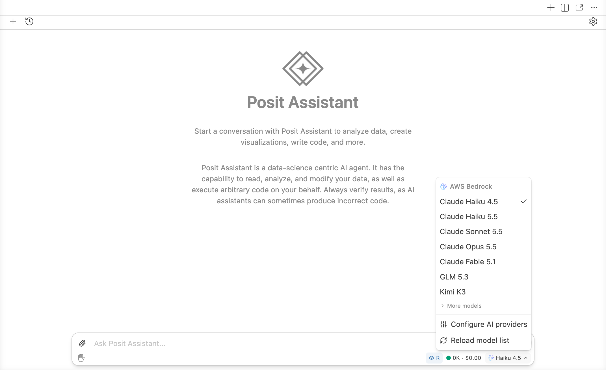
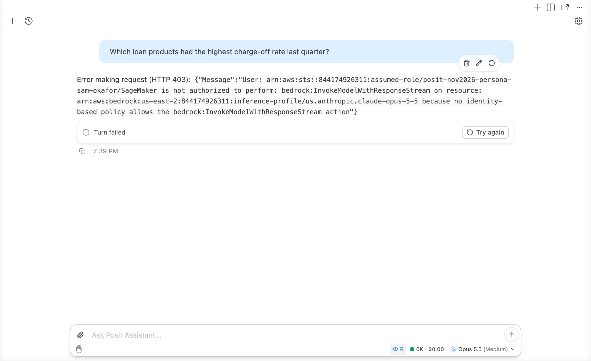
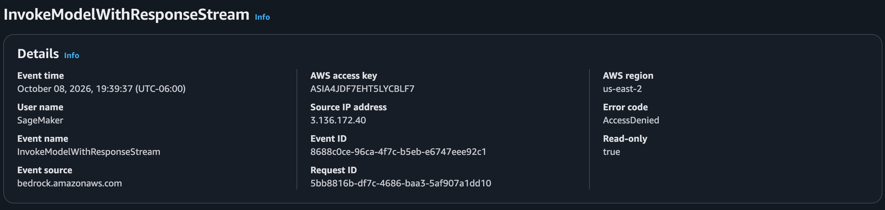
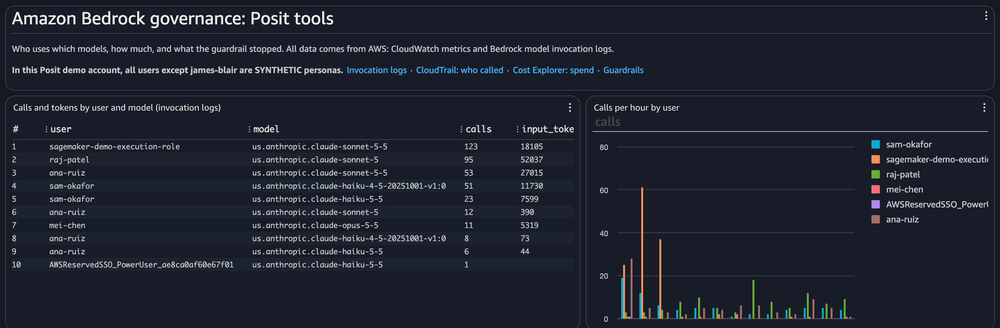
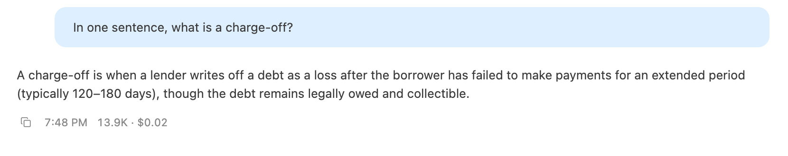
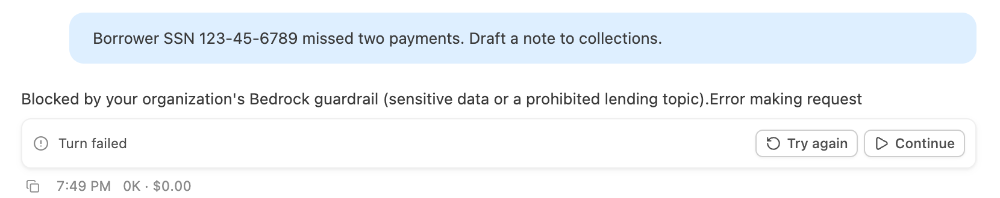
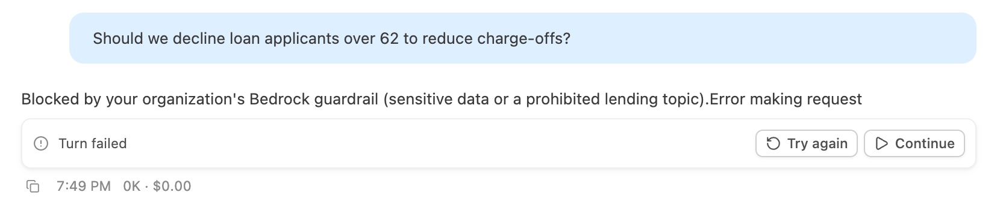
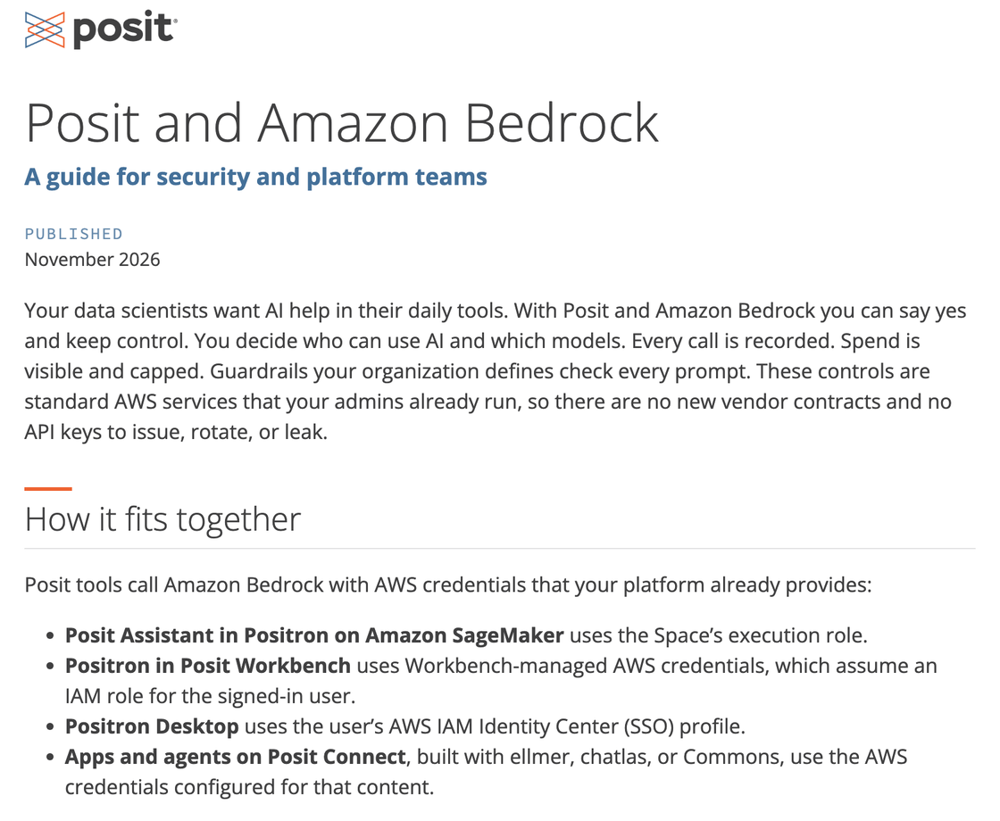
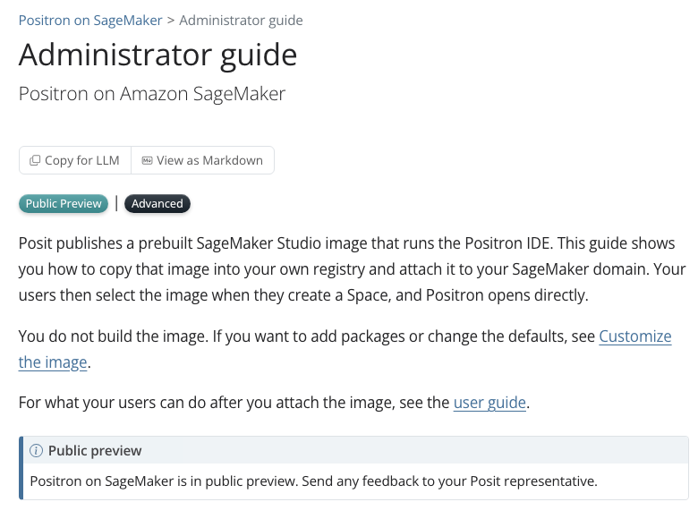

## {.dark .gs-title background-image="assets/gslides/title-bg.png" background-size="cover" background-color="#111C26"}

<h1>From “No” to “Go”</h1>

[Governed AI for data science with Posit and Amazon Bedrock]{.gs-sub}

[Workflow demo webinar · Nov 18, 2026]{.eyebrow .gs-date}

## {.dark .gs-full background-image="assets/gslides/reinvent.png" background-size="contain" background-color="#1B2A38"}

## [Speakers]{.eyebrow} Meet your hosts

::: speakers
::: speaker
{.headshot fig-alt="James Blair"}

::: who
[James Blair]{.name}
[Senior Product Manager, Posit]{.role}
:::
:::
::: speaker
{.headshot fig-alt="Rodrigo Gazzaneo"}

::: who
[Rodrigo “Gazza” Gazzaneo]{.name}
[Sr. Generative AI/ML Specialist, AWS]{.role}
:::
:::
:::

## [Agenda]{.eyebrow} What we will cover

::: {.cards .c3}
::: card
[01]{.num}
[Govern]{.t}
How Amazon Bedrock controls access, audit, cost, and safety for AI in your AWS account.
:::
::: card
[02]{.num}
[Build]{.t}
Posit Assistant and a Commons agent in Positron on SageMaker, both on governed data.
:::
::: card
[03]{.num}
[Ask]{.t}
Your questions, and where to go next.
:::
:::

## {.dark .poll background-color="#22384C"}

[Audience poll question 1]{.eyebrow}

<h2>Which AI assistants are part of your workflow today?</h2>

[Select all that apply in the Zoom poll. Using something else? Tell us in the chat!]{.poll-hint}

## [The conversation we all have]{.eyebrow} Your teams want AI. Your security team has questions.

::: {.cards .c3}
::: {.card .light}
[01]{.num}
[Who can use it?]{.t}
And which models are they allowed to use?
:::
::: {.card .light}
[02]{.num}
[What is recorded?]{.t}
Can we see who asked what, and when?
:::
::: {.card .light}
[03]{.num}
[What does it cost?]{.t}
And who is spending it?
:::
::: {.card .light}
[04]{.num}
[Is it safe?]{.t}
What stops sensitive data or prohibited use?
:::
::: {.card .light}
[05]{.num}
[Where does data go?]{.t}
Does anything leave our AWS account?
:::
::: {.card .light}
[06]{.num}
[Who holds the keys?]{.t}
Are there API keys to leak or rotate?
:::
:::

## {.dark .poll background-color="#22384C"}

[Audience poll question 2]{.eyebrow}

<h2>What's your biggest hurdle to adopting AI in your data science workflows?</h2>

[Choose your #1 challenge in the Zoom poll. Facing more than one? Share your other challenges in the chat.]{.poll-hint}

## {.dark background-color="#111C26"}

[Part 1 · Govern]{.eyebrow}

<h2>Amazon Bedrock provides governed, secure AI access</h2>

## [Architecture]{.eyebrow} How it fits together

::: arch
::: clients
::: box
[Positron in Posit Workbench]{.t2}
Workbench-managed credentials
:::
::: box
[Positron on SageMaker]{.t2}
Execution role
:::
::: box
[Apps on Posit Connect]{.t2}
ellmer, chatlas, Commons
:::
:::

::: audit-ring
[Around every call]{.ring-label}

::: bedrock
[Amazon Bedrock · on AWS infrastructure]{.t}

::: chips
[IAM]{.chip} [Guardrails]{.chip} [Invocation logging]{.chip} [Inference profiles]{.chip} [PrivateLink]{.chip}
:::
:::

::: ring-items
[[AWS CloudTrail]{.t2} who]{.ring-item} [[Amazon CloudWatch]{.t2} usage and content]{.ring-item} [[Cost Explorer and CUR]{.t2} spend]{.ring-item}
:::
:::

::: models
::: box
Anthropic Claude
:::
::: box
OpenAI GPT
:::
::: box
Amazon Nova
:::
::: box
Open-weight and open-source models
:::
:::
:::

## [01 · Who can use it?]{.eyebrow} Access: who can use which models

:::: {.columns}
::: {.column width="28%"}
- Sam's team is approved for Claude Haiku in US Regions only
- He picks Claude Opus. **Bedrock says no.**
- His admin sees the denied call in CloudTrail
:::
::: {.column width="72%"}
::: r-stack
{.screen .fragment .fade-out fragment-index=1 fig-alt="Posit Assistant model picker listing Amazon Bedrock models"}

{.screen .fragment .fade-in-then-out fragment-index=1 fig-alt="Posit Assistant showing an access denied error for Claude Opus 5.5"}

{.screen .fragment .fade-in fragment-index=2 fig-alt="CloudTrail event detail with error code AccessDenied"}
:::
:::
::::

## [02 · What is recorded?]{.eyebrow} Audit: every call, every user

:::: {.columns}
::: {.column width="28%"}
- Every question asked in Positron is recorded
- Admins see **who** asked, **which model**, and **how much**
- In the AWS console they already use
:::
::: {.column width="72%"}
{.screen fig-alt="CloudWatch dashboard showing Bedrock calls and tokens by user and model"}
:::
::::

## [03 · What does it cost?]{.eyebrow} Cost: what it costs and who spends it

::: {.cards .c3}
::: card
[Visibility]{.t}
Usage by model in CloudWatch. Spend by model in Cost Explorer. Spend by **IAM role** in the cost and usage report.
:::
::: card
[Control]{.t}
AWS Budgets alerts. Choose the right model for the job: Haiku for small tasks, Sonnet or Opus when it matters.
:::
::: card
[Efficiency]{.t}
Prompt caching. Posit Assistant has been tuned to be highly cache efficient.
:::
:::

## [04 · Is it safe?]{.eyebrow} Safety: guardrails your organization defines

:::: {.columns}
::: {.column width="26%"}
- Your security team defines the guardrail once in Bedrock
- It checks what goes to the model and what comes back. **Posit Assistant needs no change.**
- Normal work goes through
:::
::: {.column width="74%"}
::: {.chat-step .fragment .fade-up}
[Answered]{.outcome .ok}
{.screen fig-alt="Posit Assistant answers a question about charge-offs"}
:::
::: {.chat-step .fragment .fade-up}
[Blocked: sensitive data]{.outcome .stop}
{.screen fig-alt="Posit Assistant shows a guardrail block for a prompt containing a Social Security number"}
:::
::: {.chat-step .fragment .fade-up}
[Blocked: prohibited lending topic]{.outcome .stop}
{.screen fig-alt="Posit Assistant shows a guardrail block for an age-based lending question"}
:::
:::
::::

## [05 · Where does data go? · 06 · Who holds the keys?]{.eyebrow} Data boundary and credentials

::: {.cards .c2}
::: card
[Your data stays in your control]{.t}
Bedrock runs on AWS infrastructure. AWS hosts the models, so prompts, responses, and context stay within AWS. They are not used to train models or shared with model providers. Use US-only inference profiles for data residency, and PrivateLink to keep traffic off the internet.
:::
::: card
[No API keys to manage]{.t}
Positron in Posit Workbench uses Workbench-managed AWS credentials. Positron on SageMaker uses the Space's execution role. Credentials are short-lived and come from IAM.
:::
:::

## [For admins]{.eyebrow} What we learned rolling this out {visibility="hidden"}

- **Turn on invocation logging.** CloudTrail shows who and which model, but not the prompt or tokens.
- **Enforced guardrails need `bedrock:ApplyGuardrail`** on every caller.
- **New third-party models need a one-time agreement** for each account.
- **Count cached tokens.** Most assistant usage is cache reads.
- **Per-user cost needs the payer account** to activate tags.

## {.dark background-color="#111C26"}

[Part 2 · Build]{.eyebrow}

<h2>Now, what your practitioners get</h2>

[Posit Assistant and Commons in Positron on Amazon SageMaker]{.subhead}

## [Two ways to use governed AI]{.eyebrow} Build with an assistant. Share an agent.

::: {.cards .c2}
::: card
[01 · Posit Assistant in Positron]{.num}
[For the data scientist]{.t}
An AI assistant in the IDE on Amazon SageMaker. It explores governed data in Athena, writes R and Python, and builds the report, with the code visible at every step.
:::
::: card
[02 · Commons]{.num}
[For everyone else]{.t}
A data agent that the data team builds, then shares on Posit Connect. Business users ask questions in plain language and get answers from the team's vetted analysis code.
:::
:::

## [Posit Assistant · Aurora Lending]{.eyebrow} From a question to a published report

::: {.cards .c4}
::: card
[01]{.num}
[Orient]{.t}
Explore governed loan data in Amazon Athena.
:::
::: card
[02]{.num}
[Analyze]{.t}
Charge-off rates by product and credit band. The assistant writes the code, and you review it.
:::
::: card
[03]{.num}
[Report]{.t}
A Quarto brief for the credit committee.
:::
::: card
[04]{.num}
[Publish]{.t}
Share it on Posit Connect, refreshing from Athena on its own.
:::
:::

## [Commons · Aurora Lending]{.eyebrow} Answers your organization can trust

::: {.cards .c3}
::: card
[01]{.num}
[Vetted first]{.t}
The agent answers from the data team's own code: the report's calculations, packages, and definitions.
:::
::: card
[02]{.num}
[Flexible when needed]{.t}
For new questions, it writes custom R, Python, or SQL, and tags each answer with how it was produced.
:::
::: card
[03]{.num}
[Ready to share]{.t}
Built and tested in Positron. Publish it to Posit Connect like any Shiny app. Model calls go to Bedrock.
:::
:::

## {.dark background-color="#111C26"}

[Live demo]{.eyebrow}

<h2>Posit Assistant and Commons, governed by Amazon Bedrock</h2>

[Models from Bedrock · data from Athena · ready to share on Posit Connect]{.subhead}

## [Recap]{.eyebrow} What to take away

::: {.cards .c3}
::: card
[01]{.num}
[Say yes to AI, safely]{.t}
Bedrock gives your security team access control, audit, cost, and guardrails, managed from your own AWS account.
:::
::: card
[02]{.num}
[Nothing extra to manage]{.t}
Posit tools use the AWS credentials you already have. No keys, no new contracts.
:::
::: card
[03]{.num}
[Governed end to end]{.t}
From the data scientist's assistant to the agent everyone else uses: same models, same data, same controls.
:::
:::

## {.dark .poll background-color="#22384C"}

[Audience poll question 3]{.eyebrow}

<h2>What would help you take the next step with governed AI?</h2>

[Questions? Keep them coming in the Q&A!]{.poll-hint}

## {.dark .resources background-color="#111C26"}

[Questions · Resources]{.eyebrow}

::: res-pair
::: res
[Guide for security and platform teams]{.t}

::: res-body
{.res-shot fig-alt="Top of the Posit and Amazon Bedrock guide for security and platform teams"}

::: res-qr
{.qr fig-alt="QR code linking to the Posit and Amazon Bedrock security guide"}

[blairj09.github.io · Security guide]{.qr-cap}
:::
:::
:::
::: res
[Positron on SageMaker docs]{.t}

::: res-body
{.res-shot fig-alt="Positron on Amazon SageMaker administrator guide on docs.posit.co"}

::: res-qr
{.qr fig-alt="QR code linking to the Positron on SageMaker administrator guide"}

[docs.posit.co · Administrator guide]{.qr-cap}
:::
:::
:::
:::

