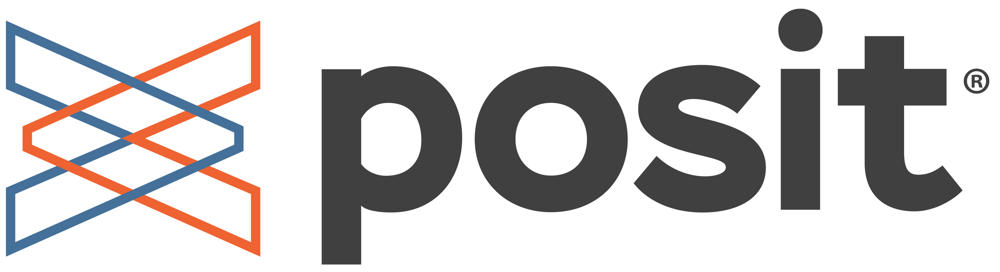
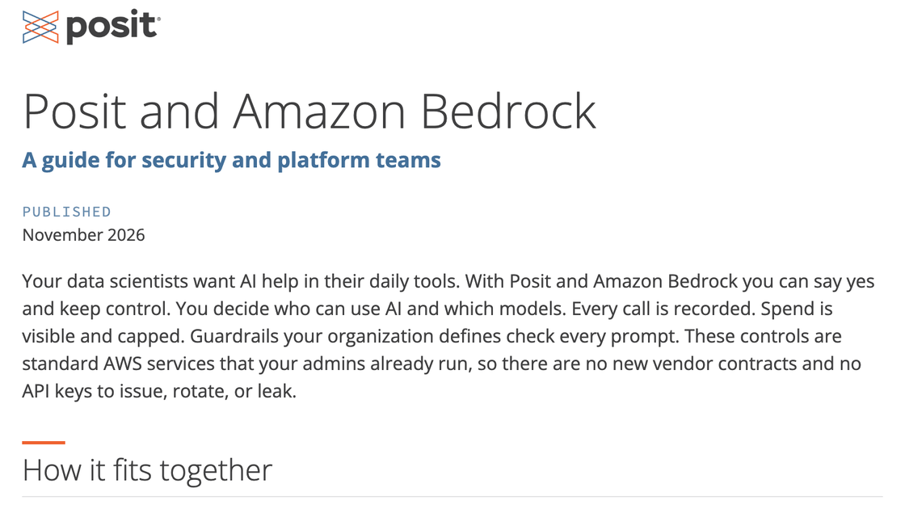

```{=html}
<main class="landing">
  

  <p class="landing-eyebrow">Workflow demo webinar · November 18, 2026</p>
  <h1 class="landing-title">From “No” to “Go”</h1>
  <p class="landing-sub">Governed AI for data science with Posit and Amazon Bedrock</p>

  <div class="tiles">
    <a class="tile" href="deck/webinar.html">
      
      <div class="tile-body">
        <h2>Slides</h2>
        <p>The webinar deck: how Amazon Bedrock answers your security team's questions, and governed AI in Positron on SageMaker.</p>
        <span class="tile-cta">View slides →</span>
      </div>
    </a>

    <a class="tile" href="security-guide/security-guide.html">
      
      <div class="tile-body">
        <h2>Security guide</h2>
        <p>A guide for security and platform teams: access, audit, cost, guardrails, data boundaries, and a rollout checklist.</p>
        <span class="tile-cta">Read the guide →</span>
      </div>
    </a>
  </div>

  <p class="landing-foot">The security guide is also available as a <a href="security-guide/security-guide.pdf">PDF</a>.</p>
</main>
```
